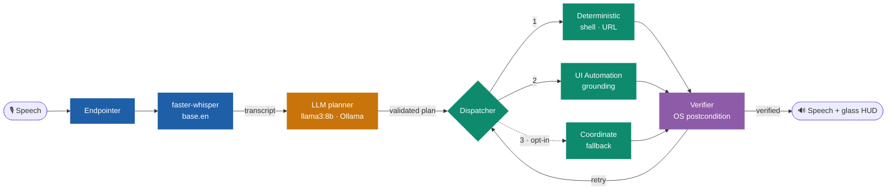

<div align="center">


# Clavix

### Say it. Clavix plans it, does it, *and checks it*.

Voice-to-action automation for the Windows desktop: local, closed-loop and verified.

<br>



<br><br>

[](https://github.com/KrishKamra/Clavix/actions/workflows/ci.yml)
[](LICENSE)
[](https://www.python.org)
[](#-quick-start)
[](https://github.com/astral-sh/uv)
[](https://github.com/astral-sh/ruff)
[](https://mypy-lang.org)

[](https://ollama.com)
[](https://github.com/SYSTRAN/faster-whisper)
[](https://learn.microsoft.com/windows/win32/winauto/entry-uiauto-win32)
[](https://developer.microsoft.com/microsoft-edge/webview2)
[](https://docs.pydantic.dev)
[](https://pytest.org)

[**Results**](docs/RESULTS.md) · [**Architecture**](docs/ARCHITECTURE.md) · [**Quick start**](#-quick-start) · [**Contributing**](CONTRIBUTING.md) · [**Cite**](#-citation)

</div>

---

Voice assistants answer questions; they rarely *operate* the apps you actually use. LLM agents can,
but they act open-loop: when a click misses or a file is never written, they don't notice.

**Clavix closes the loop.** It turns one spoken command into a schema-validated plan, runs each step
on the most deterministic route available, and **checks every step against the real state of the
operating system** before moving on. Speech recognition and planning run entirely on your machine.

## ✨ Highlights

<table>
<tr>
<td width="33%" valign="top">

### 🔒 Local
Whisper and the LLM run on the device's CPU. With the default planner, no audio, transcript or
screen content leaves your machine.

</td>
<td width="33%" valign="top">

### 🎯 Deterministic first
Shell commands and URLs before UI, accessibility tree before pixels. Coordinate clicks are off by
default.

</td>
<td width="33%" valign="top">

### ✅ Verified
Every step has an OS-level postcondition (a window, process, file or output) that is polled,
retried and enforced.

</td>
</tr>
</table>

## 📊 Results at a glance

<div align="center">

| | Reference plans | `llama3:8b` plans | From real speech |
|:---|:---:|:---:|:---:|
| **Task success** | **50 / 50** | **30 / 30** | **44 / 50** |
| Exact transcripts | | | **50 / 50** |

| UI tasks, without → with accessibility grounding | ASR latency after speech ends | Share of the wait spent planning |
|:---:|:---:|:---:|
| **0/3 → 15/15** | **441 ms** (`base.en`, CPU) | **90 %** (local LLM) |

</div>

> [!NOTE]
> All runs are on a laptop CPU (Intel Core Ultra 9 285H, no GPU), with machine-checked ground truth
> and failures reported as measured. **[Full results, method and hardware →](docs/RESULTS.md)**

## 🧠 How it works



1. **Hear.** An energy endpointer detects the end of speech, and Faster-Whisper transcribes it on the CPU.
2. **Think.** A local LLM writes a plan of typed actions. Pydantic validates it, and an invalid plan
   goes back to the LLM for repair.
3. **Act.** Each step runs on the most deterministic route that can do it.
4. **Verify.** The step's postcondition is checked against live OS state, with bounded retries.

The **glass safety HUD** shows every stage live. It never takes focus, is invisible to screen
capture, and is skipped by grounding. Its Stop button, or <kbd>Esc</kbd> <kbd>Esc</kbd>, aborts the task.

**[Architecture, state machine and module contracts →](docs/ARCHITECTURE.md)**

## 🚀 Quick start

> [!IMPORTANT]
> Requirements: **Windows 11**, [**uv**](https://docs.astral.sh/uv/), [**Ollama**](https://ollama.com)
> and a microphone. The core and its tests also run on Linux and macOS, without the desktop modules.

```powershell
git clone https://github.com/KrishKamra/Clavix.git
cd Clavix
uv sync --all-extras          # Python 3.12, Whisper, UI Automation, speech, HUD
ollama pull llama3:8b

uv run clavix                 # speak a command after the "listening" line
uv run clavix "open notepad and click the file menu"   # or type one
```

Pick a microphone in a git-ignored `configs/local.yaml` (`modules.acoustic.options.input_device`)
and run `uv run clavix --config configs/local.yaml`.

<details>
<summary><b>Try these commands</b></summary>

| Command | What Clavix does |
|---|---|
| *"open github"* | Opens the URL and waits for the window |
| *"create a file called note.txt in the workspace containing hello"* | Writes the file and checks it exists |
| *"take a screenshot and save it to the workspace as screen.png"* | Captures the screen (the HUD is excluded) |
| *"open notepad and click the file menu"* | Launches Notepad, finds **File** in the accessibility tree, opens it |
| *"click the start button"* | Finds **Start** on the taskbar by name |

</details>

<details>
<summary><b>Run the benchmark</b></summary>

```powershell
uv run clavix-bench --planner reference --repeat 5 --cleanup     # execution + verification only
uv run clavix-bench --planner llm --repeat 3 --cleanup           # plans from a local LLM
uv run clavix-bench --planner llm --audio --repeat 5 --cleanup   # end to end from recorded speech
```

> [!WARNING]
> The benchmark drives your real desktop: it opens browser tabs and Notepad, writes files and takes
> screenshots. Save your work first and don't use the machine while it runs.

</details>

## 🛡️ Safety

| Guard | What it does |
|---|---|
| Blocked commands | `execution.blocked_command_patterns`: the dispatcher refuses matching shell commands |
| Typed plans | Only a fixed vocabulary of actions, each validated before anything runs |
| No blind clicking | The coordinate fallback is off by default and needs explicit coordinates |
| Abort | HUD Stop button, <kbd>Esc</kbd> <kbd>Esc</kbd>, or the PyAutoGUI corner fail-safe |

See [SECURITY.md](SECURITY.md) to report a vulnerability.

## 📚 Documentation

| Document | Read it to… |
|---|---|
| [**Results**](docs/RESULTS.md) | see every benchmark, the hardware and how to reproduce the numbers |
| [**Architecture**](docs/ARCHITECTURE.md) | understand the loop, the dispatch ladder, plans and module contracts |
| [HUD design](docs/design/HUD_DESIGN.md) | see the glass HUD's design system and Windows recipe |
| [Roadmap](docs/ROADMAP.md) | see who built what, phase by phase |
| [Member specs](docs/specs/) | read the specification each module was built against |
| [Contributing](CONTRIBUTING.md) · [Agents](AGENTS.md) | open a pull request, alone or with an AI assistant |
| [Changelog](CHANGELOG.md) | see what changed in each release |

## 👥 Team

Built at the **Department of Artificial Intelligence, MPSTME, NMIMS University, Mumbai**.

| Member | Built |
|---|---|
| **Krish Kamra** | Architecture, agent core, planner, dispatcher, verifier, evaluation and integration |
| **Shreyash Pathak** | Acoustic ingestion: endpointing and Faster-Whisper |
| **Varun Agrawal** | Structural grounding with Windows UI Automation |
| **Aditya Angane** | Spoken feedback, the glass safety HUD and the abort hotkey |

More in [AUTHORS.md](AUTHORS.md).

## 📝 Citation

If Clavix helps your research, please cite it ([CITATION.cff](CITATION.cff)):

```bibtex
@software{clavix2026,
  title  = {Clavix: Deterministic, Closed-Loop Voice-to-Action Automation of the Windows Desktop},
  author = {Kamra, Krish and Pathak, Shreyash and Agrawal, Varun and Angane, Aditya},
  year   = {2026},
  url    = {https://github.com/KrishKamra/Clavix},
  version = {0.1.0}
}
```

## ⚖️ License

[MIT](LICENSE) © 2026 Krish Kamra, Shreyash Pathak, Varun Agrawal and Aditya Angane.

<div align="center"><sub>Made with care in Mumbai · <a href="CODE_OF_CONDUCT.md">Code of conduct</a></sub></div>
