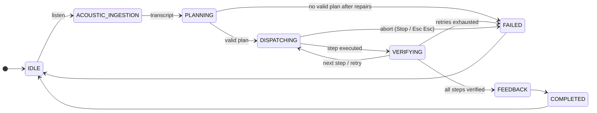
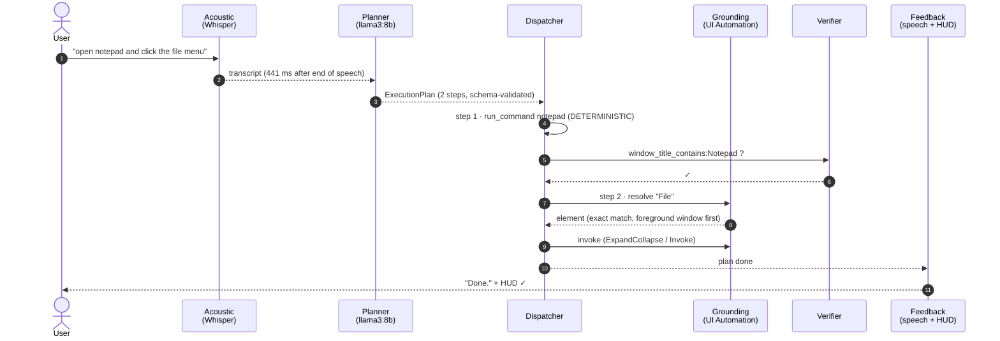
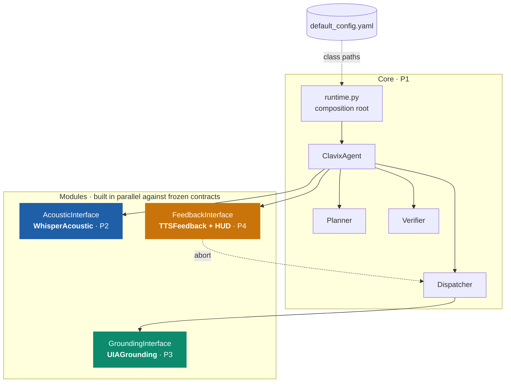

<div align="center">


# Architecture

**One spoken command → one validated plan → steps that are executed *and checked*.**

</div>

## Contents

- [The closed loop](#the-closed-loop)
- [One command, step by step](#one-command-step-by-step)
- [The dispatch ladder](#the-dispatch-ladder)
- [Plans](#plans)
- [Postconditions](#postconditions)
- [Modules and contracts](#modules-and-contracts)
- [Code layout](#code-layout)

## The closed loop

`ClavixAgent` (`clavix/core/state_machine.py`) is an asyncio state machine. Every state change is
published to the feedback module, which drives speech and the HUD.



## One command, step by step



## The dispatch ladder

Each step runs on the **most deterministic route that can do it**.

| Priority | Route | Mechanism | Example |
|:---:|---|---|---|
| **1** | `DETERMINISTIC` | Shell command (`cmd.exe`), URL / protocol handler, screenshot | `run_command`, `launch_url` |
| **2** | `OS_GROUNDING` | Find the element by accessible name in the UI Automation tree, then activate it through a UIA pattern | `click_element "File"` |
| **3** | `VISUAL_FALLBACK` | Coordinate click with PyAutoGUI. **Off by default**, and it requires explicit coordinates | `click_element` + `fallback_coord` |

> [!NOTE]
> Grounding searches the foreground window first, then the taskbar, then the other visible windows
> front to back. An exact name match beats a partial one, and every window gets a share of the time
> budget, so one huge browser page cannot starve the search. The HUD's own window is always skipped.

## Plans

The LLM writes only `steps`. Clavix adds `plan_id` and `original_prompt`, validates the result with
Pydantic, and sends any validation error back to the LLM for up to `planner.max_retries` repairs.

```json
{
  "steps": [
    {"step_id": 1, "action_type": "DETERMINISTIC", "action_name": "run_command",
     "payload": {"cmd": "notepad", "detach": true},
     "expected_postcondition": "window_title_contains:Notepad"},
    {"step_id": 2, "action_type": "OS_GROUNDING", "action_name": "click_element",
     "payload": {"target_label": "File"},
     "expected_postcondition": null}
  ]
}
```

| `action_name` | `action_type` | Payload |
|---|---|---|
| `launch_url` | DETERMINISTIC | `url` |
| `run_command` | DETERMINISTIC | `cmd`, `timeout_sec=10`, `detach=false` |
| `take_screenshot` | DETERMINISTIC | `filepath`, `target_region=[left, top, width, height]?` |
| `click_element` | OS_GROUNDING / VISUAL_FALLBACK | `target_label`, `fallback_coord=[x, y]?` |
| `speak_feedback` | FEEDBACK | `message`, `blocking=false` |

## Postconditions

Postconditions have the form `<kind>:<argument>`. The first three kinds are polled for up to
`verifier.timeout_sec`, because the OS takes time to catch up.

| Kind | Checks | Polled |
|---|---|:---:|
| `window_title_contains` | A visible window's title contains the text | ✅ |
| `process_running` | A process with that image name exists | ✅ |
| `file_exists` | The path exists | ✅ |
| `exit_code` | The step's command returned this code | |
| `stdout_contains` | The step's output contains the text | |

## Modules and contracts

The core never imports a concrete module. Each module implements an interface in
`clavix/modules/`, must pass its conformance suite in `clavix/testing/contracts.py`, and is selected
in [`configs/default_config.yaml`](../configs/default_config.yaml) under `modules.<name>.class`.



| Interface | Implementation | Key methods | Extra |
|---|---|---|---|
| `AcousticInterface` | `WhisperAcoustic` | `listen() → Transcript(text, t_asr_ms, confidence)` | `acoustic` |
| `GroundingInterface` | `UIAGrounding` | `resolve_element`, `invoke_element`, `click_coordinate` | `grounding` |
| `FeedbackInterface` | `TTSFeedback` | `speak`, `on_state_change`, `on_event`, `request_abort` | `feedback` |

> [!TIP]
> Each interface also has a console or in-memory stand-in (`ConsoleAcoustic`, `ConsoleFeedback`,
> fakes in `clavix/testing/fakes.py`), so the whole agent runs and is tested on headless Linux.

## Code layout

```text
clavix/
├── core/
│   ├── state_machine.py     ClavixAgent: the async closed loop
│   ├── planner.py           Prompt, Ollama/Gemini/mock clients, schema-repair loop
│   └── verifier.py          Postcondition checks on live OS state
├── execution/
│   ├── dispatcher.py        Route ladder, safety policy, abort, PyAutoGUI fail-safe
│   └── native_ops.py        launch_url, run_cli, spawn_process, take_screenshot
├── modules/
│   ├── acoustic_whisper.py  P2 · endpointing + Faster-Whisper
│   ├── grounding_uia.py     P3 · UI Automation search and invocation
│   ├── feedback_tts.py      P4 · speech worker, abort hotkey
│   ├── hud.py, hud_web/     P4 · glass HUD process (WebView2)
│   └── *.py                 interfaces and console stand-ins
├── schemas/                 ActionStep, ExecutionPlan, telemetry records
├── evaluation/              clavix-bench harness and metrics
├── testing/                 fakes and conformance contract suites
├── runtime.py               composition root
└── config.py                typed config
configs/                     default_config.yaml, benchmark_suite.json
docs/                        this file, results, roadmap, member specs, HUD design
```
