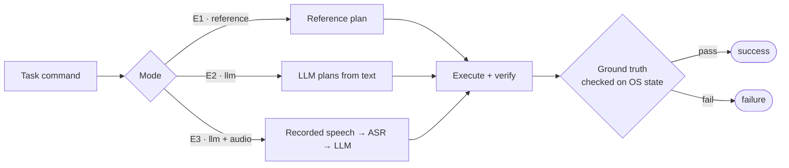

<div align="center">


# Results

**Every number on this page comes from a result file produced by `clavix-bench` on the machine below.**

</div>

> [!TIP]
> **The short version.**
> - Every text command succeeds: **50/50** runs with reference plans and **30/30** with a local `llama3:8b`.
> - From real recorded speech, **44/50** runs succeed and **50/50** transcripts are exact.
> - Accessibility grounding takes UI tasks from **0/3 to 15/15**.
> - Speech recognition needs **441 ms** after you stop talking; **90 %** of the wait is the local LLM.

## Contents

- [Test machine](#test-machine)
- [The benchmark](#the-benchmark)
- [E1 · Execution with reference plans](#e1--execution-with-reference-plans)
- [E2 · Planning with a local LLM](#e2--planning-with-a-local-llm)
- [E3 · End to end from speech](#e3--end-to-end-from-speech)
- [Speech recognition](#speech-recognition)
- [Grounding](#grounding)
- [Feedback and HUD](#feedback-and-hud)
- [Reproducing the numbers](#reproducing-the-numbers)

## Test machine

| | |
|---|---|
| **Laptop** | ASUS Zenbook 14 (UX3405CA) |
| **CPU** | Intel Core Ultra 9 285H, 16 cores |
| **Memory** | 32 GB |
| **GPU** | Intel Arc 140T (integrated). Not used: everything runs on the CPU. |
| **OS** | Windows 11, build 26300 |
| **Python** | 3.12.13 (uv) |
| **ASR** | faster-whisper 1.2.1 (CTranslate2 4.8.4), `base.en`, int8, beam 1 |
| **Planner** | Ollama 0.40.13: `llama3:8b` (default), `mistral:7b`, temperature 0 |
| **Microphone** | Sony WH-CH520 headset, quiet room, one speaker |

## The benchmark

Ten everyday Windows tasks in three tiers, each with **machine-checkable ground truth**: a file
that must exist with given contents, command output, a launched application, or a window title.

| Tier | What it tests | Example | Tasks |
|:---:|---|---|:---:|
| **1** | One deterministic action | *"run echo clavix ready"* | 4 |
| **2** | Sequences of actions | *"make a folder called reports in the workspace and put a file summary.txt in it saying done"* | 3 |
| **3** | Clicking real UI elements | *"open notepad and click the file menu"* | 3 |

The full suite is [`configs/benchmark_suite.json`](../configs/benchmark_suite.json).



## E1 · Execution with reference plans

The planner is replaced by each task's reference plan, so this measures execution and verification
alone (5 runs per task).

| Configuration | Tier 1 | Tier 2 | Tier 3 | **All** |
|---|:---:|:---:|:---:|:---:|
| Phase 1 baseline (no grounding) | 4/4 | 3/3 | 0/3 | 7/10 |
| **Clavix, UI Automation grounding** | **20/20** | **15/15** | **15/15** | **50/50** |

| Median execution time | Tier 1 | Tier 2 | Tier 3 |
|---|:---:|:---:|:---:|
| per task | 152 ms | 173 ms | 886 ms (p95 3.7 s) |

> [!NOTE]
> Every Tier 3 click landed on the intended element (*File*, *Start*, *Search*) through the
> accessibility tree; the coordinate fallback was never used.

## E2 · Planning with a local LLM

The LLM plans from the raw command text (3 runs per task). *Action match* compares the planned
action sequence with the reference plan; *exact* also compares every payload.

| Planner | Tier 1 | Tier 2 | Tier 3 | **All** | Action match | Exact |
|---|:---:|:---:|:---:|:---:|:---:|:---:|
| **`llama3:8b`** | **12/12** | **9/9** | **9/9** | **30/30** | **100 %** | 40 % |
| `mistral:7b` | 12/12 | 6/9 | 3/9 | 21/30 | 72 % | n/a |

A plan can differ from the reference and still be correct: *exact* is low because the model
chooses equivalent commands and paths, while ground truth is checked on the real OS. `mistral:7b`
fails mostly in planning: it opened the website *notepad.com* instead of Notepad, and it named the
taskbar's *Search* button "Search box". The prompt was developed with `llama3:8b`.

## E3 · End to end from speech

The commands are played from human recordings through the full pipeline: endpointing, ASR,
LLM, execution and verification (5 runs per task).

| | Tier 1 | Tier 2 | Tier 3 | **All** |
|---|:---:|:---:|:---:|:---:|
| Task success | 15/20 | 14/15 | 15/15 | **44/50** |
| Exact transcripts | 20/20 | 15/15 | 15/15 | **50/50** |

| Median latency (s) | ASR | LLM planning | Execution |
|---|:---:|:---:|:---:|
| Tier 1 | 0.8 | 8.0 | 0.1 |
| Tier 2 | 1.2 | 22.8 | 0.2 |
| Tier 3 | 0.4 | 9.9 | 0.7 |
| **All runs** | **0.76** | **90 % of the 10.7 s median** | |

> [!IMPORTANT]
> **Five of the six failures are a single task, T1-02.** The transcript *"Run echo Clavix ready."* is
> perfect, but its capitals and full stop flow into the `echo` command, so the output check fails.
> A perfect transcript can still change an action. The sixth failure is an LLM request that hit its
> 60 s timeout.

> [!CAUTION]
> ASR took 0.76 s here against 441 ms in isolation: this run followed hours of CPU-bound LLM
> inference, and the laptop was thermally throttled. We report it as measured.

## Speech recognition

Ten human-recorded commands, CPU only. Latency runs from the end of speech, so the endpointer's
silence wait is excluded by construction.

| Model | Median latency | p95 | WER (human speech) |
|---|:---:|:---:|:---:|
| `tiny.en` | 210 ms | 239 ms | 17.5 % |
| **`base.en`** (default) | **441 ms** | **495 ms** | **0.0 %** |

`tiny.en` is twice as fast, but it mishears domain words (*github* as "get up", *file* as "sign"),
and those errors change the plan. Synthetic TTS speech misjudged accuracy in both directions, so the
fixtures are human recordings.

Live, with the headset: 10 spoken commands in a row, all captured; median `t_asr_ms` 395 ms
(p95 434 ms). Closing a Bluetooth audio stream took 570 ms; moving it off the critical path cut
live ASR latency from 1071 ms to 395 ms.

## Grounding

| Measurement | Result |
|---|---|
| Resolve *Start* with an ordinary window in front | 118–139 ms |
| Resolve *Start* behind a browser page with 8,311 elements | 1.3 s |
| Tier 3 ×5 with a large browser page open | 0/15 → **15/15** after per-window search budgets |
| Desktop grounding tests | 2 failures in 4 min 16 s → **44/44 in 18 s** |

Four robustness fixes, each found by measurement on a real desktop:
1. Exact matches outrank partial ones.
2. Deadlines are checked inside the tree walk.
3. Each window gets a share of the time budget.
4. Windows are listed through Win32 rather than a UI Automation call that can block.

## Feedback and HUD

| Measurement | Result |
|---|---|
| `speak()` returns to the agent | immediately (queued on its own thread) |
| HUD cold start (prototype) | 1.2 s |
| HUD memory / idle CPU (prototype) | 157 MB / 0.16 % |
| Reference benchmark with speech, HUD and hotkey live | **10/10** |
| HUD matched by grounding | never (skipped by design) |

## Reproducing the numbers

```powershell
uv sync --all-extras
ollama pull llama3:8b
uv run clavix-bench --planner reference --repeat 5 --cleanup           # E1
uv run clavix-bench --planner llm --repeat 3 --cleanup                 # E2
uv run clavix-bench --planner llm --audio --repeat 5 --cleanup         # E3
uv run python -m clavix.evaluation.metrics benchmarks/results_<run>.csv
```

> [!WARNING]
> The benchmark drives your real desktop: it opens browser tabs and Notepad, writes files and
> takes screenshots. Close unsaved work first and don't use the machine while it runs.
